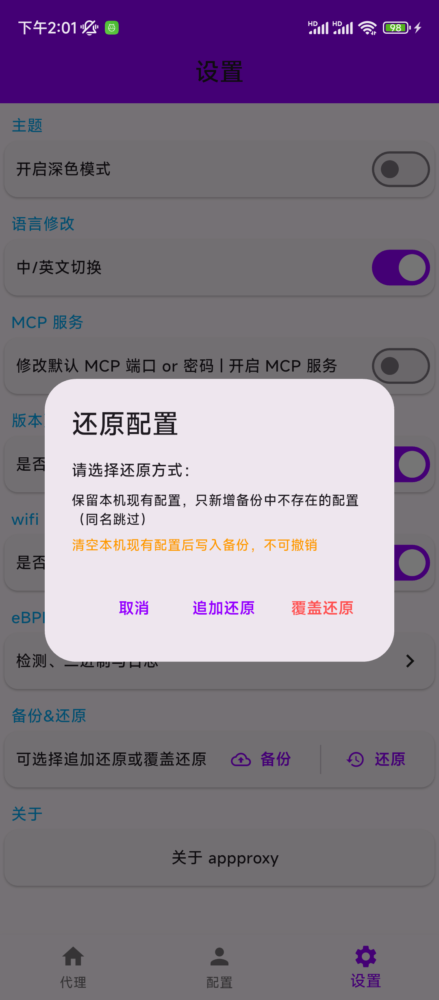
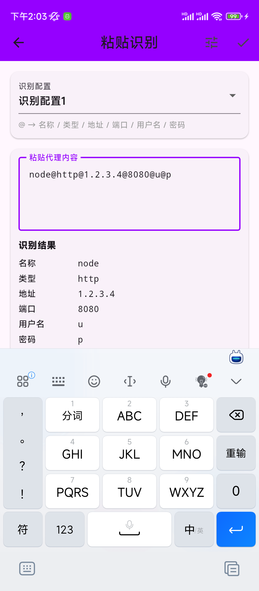
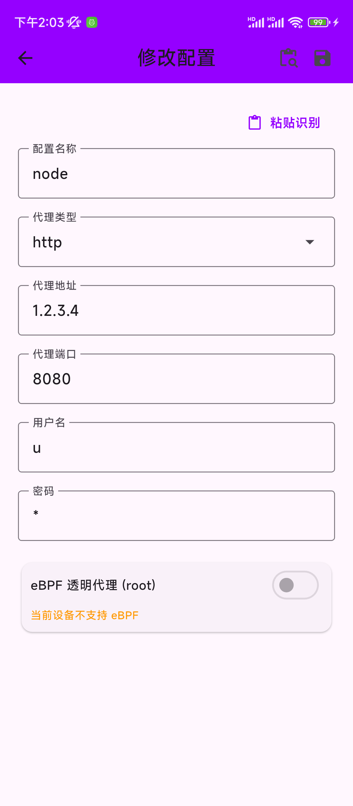
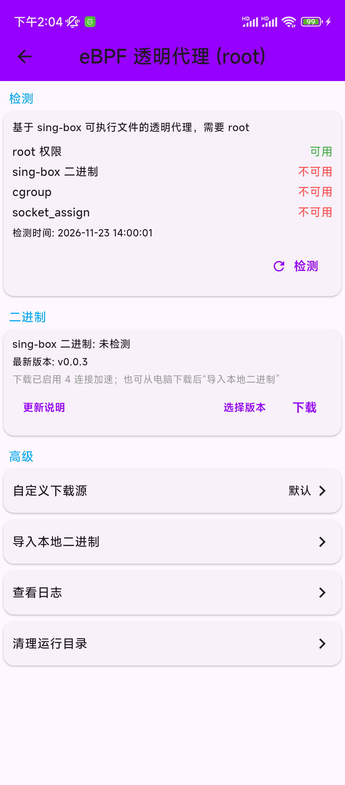
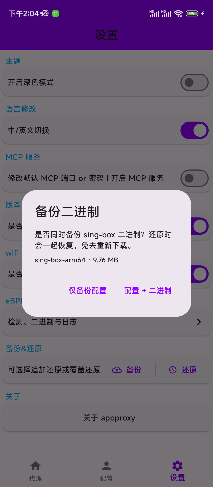

## 变更内容

- **还原备份**：新增「追加还原 / 覆盖还原」两种模式；追加模式保留本机配置、同名跳过，覆盖模式清空后写入备份。
- **粘贴识别**：添加代理页支持从粘贴内容识别字段；内置 `@` / `#` / `|` 和完整 URL 四套规则，可新增/编辑/删除规则、自定义分隔符与字段顺序。
- **配置名可修改**：双击编辑时名称可改；同步迁移设置侧 eBPF 标记与当前选中名，并做重名校验。
- **多用户/分身应用**：应用列表按用户拆分为独立行并显示用户号（如 `用户 0` / `用户 999`）；新增 root 扫描入口；同包名勾选会联动并提示；VPN 引擎启动时提示无法接管其它用户，建议使用 eBPF。
- **eBPF 二进制**：
  - 全新下载启用 4 连接分段加速，支持断点续传，服务端不支持 Range 时自动回退单连接；
  - 新增「导入本地二进制」，可在电脑下载后导入，绕过手机端慢速下载；
  - 备份可选择「配置 + 二进制」生成 ZIP，还原时配置与二进制一起恢复，并校验 ABI。
- **MCP 通知**：MCP 未开启时不再常驻 `MCP Server is not running` 通知；只有真正运行时才显示 `MCP Server is running`。

## 截图

### 1. 分身/多开应用按用户独立显示

### 2. 还原备份：追加 / 覆盖

### 3. 粘贴识别与预览

### 4. 编辑时可修改配置名

### 5. eBPF 二进制约 4 连接加速 / 本地导入入口

### 6. 备份可选包含二进制

## 兼容性与说明

- 旧版纯 `.json` 备份仍可直接还原；「配置 + 二进制」备份为 `.zip`，文件头自动识别。
- 二进制备份会记录 ABI；还原到不同 ABI 的设备时跳过二进制并提示，不会写入错误架构。
- 代理引擎仍以包名为粒度，分身同包名的多行会共享勾选状态；VPN/VpnService 无法接管其它用户，eBPF 的 `include_package` 会按包名解析 UID，推荐 eBPF。
- `lib/generated/` 按项目约定不提交，构建前请执行 `flutter pub global run intl_utils:generate`。
- 未包含任何本机环境文件（`local.properties`、keystore、构建产物等）。

## 验证

- `flutter analyze`：0 error
- `flutter test`：23/23 通过（包含解析、备份合并、改名迁移、备份包与 UI 流程）
- `flutter build apk --debug` / `--release --split-per-abi --target-platform android-arm64`：通过
- 真机（Android 13 / root）验证：
  - 粘贴识别回填、保存、双击改名
  - 追加/覆盖还原（含同名跳过与覆盖结果）
  - 分身用户 999 独立显示、勾选联动、VPN 限制提示
  - 本地导入二进制、配置+二进制 ZIP 备份与还原
  - MCP 关闭无通知 / 开启有运行通知 / 重启后自动启动
  - 原有 VPN 启停、应用勾选持久化、备份、eBPF 设置页、MCP 工具调用回归正常
